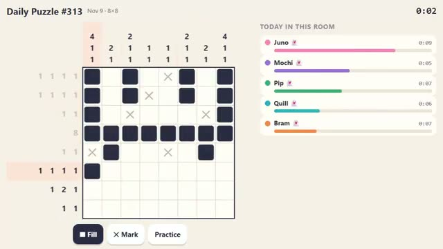

# Daily Puzzle

One new puzzle a day. Beat your friends’ time. A multiplayer starter game from [Multiplayer Agent](https://multiplayeragent.com): 2D, versus, 1+ players, with ghost solvers that race you when the room is quiet.

## How it plays

Everyone in the world gets the same picture puzzle each day. Fill the squares so every row and column matches its numbers, and a little picture appears. Your time goes on today's board, and your streak grows every day you solve it.

**Controls:** Tap or drag to fill squares; switch to ✕ Mark (or right-click) to mark empty ones.

## Make it yours in the Game Builder

Open the [Game Builder](https://multiplayeragent.com), choose **Start from a starter game** and pick Daily Puzzle. It opens as version 1 in your studio, ready to play and publish. Then ask for changes, for example:

- Switch to a five-letter word puzzle
- Add a harder puzzle on Sundays
- Add a share button with my time and streak

## Run it yourself

1. Get a free publishable key (`pk_…`) at [multiplayeragent.com](https://multiplayeragent.com).
2. In `index.html`, put it in place of `pk_REPLACE_ME` in the `MP_CONNECT` block.
3. Open `index.html` in a browser. No build step and no server needed.

Without a key it still runs, offline against ghost solvers, and your streak is kept on this device.

## How it is built

- One `index.html`. The comment at the top of the script maps the code and explains the multiplayer.
- The puzzle comes from the UTC date through a seeded random generator, and a line-by-line solver checks it has exactly one logical solution, so everyone gets the same fair puzzle.
- **Leaderboard:** One board per day: today's fastest solves.
- **Live sync:** See everyone in the room solving today's puzzle, live.
- **Live ops:** The owner can change the puzzle size or show an event banner on a schedule, with no new deploy. The game reads `size`, `fill` and `banner` from the live config, with defaults in `CONFIG`.
- **Saves:** Your streak is kept in your player save.
- **Bots:** Ghost solvers race you when the room is quiet.
- **Practice** gives you a fresh random puzzle any time; it doesn't go on the board.
- `?attract` runs it offline: an autopilot solves while ghosts race. The preview video is recorded from it.

## License

MIT.
